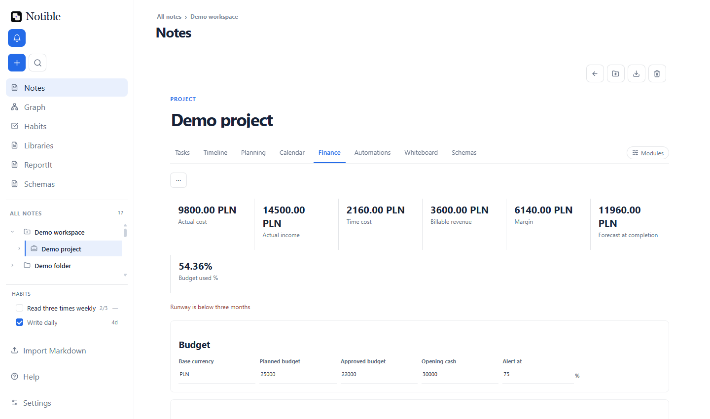
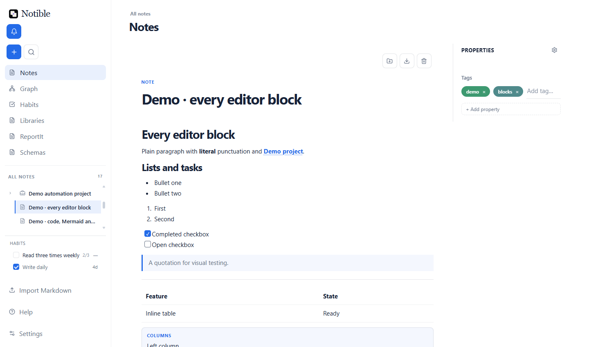
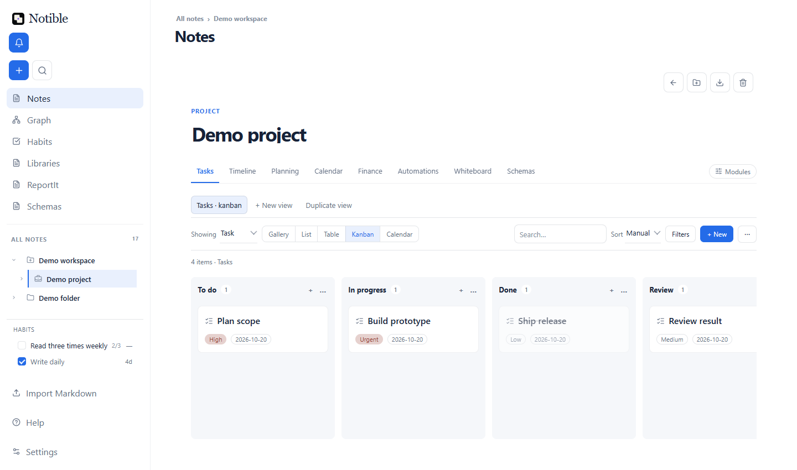
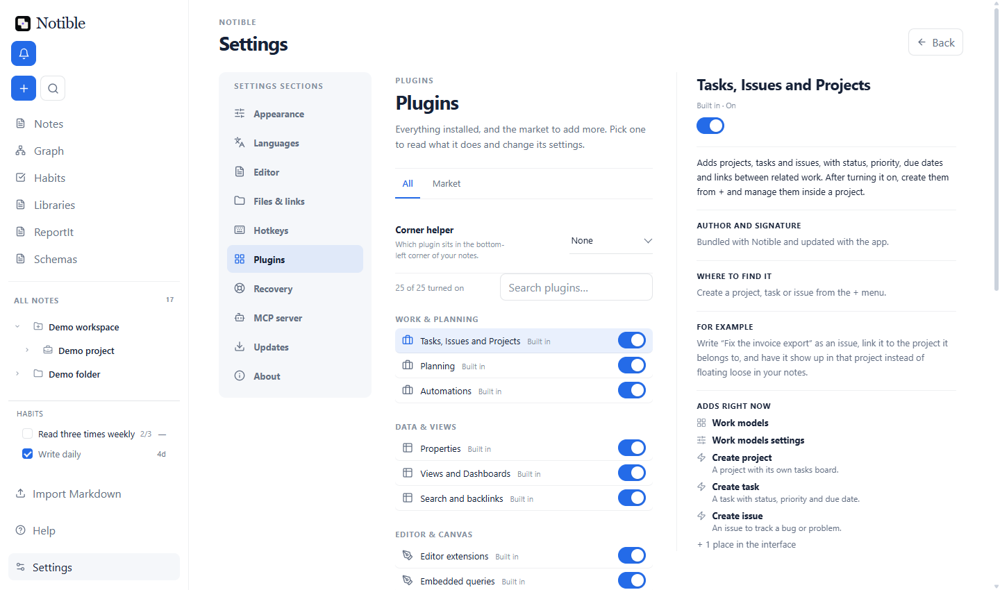
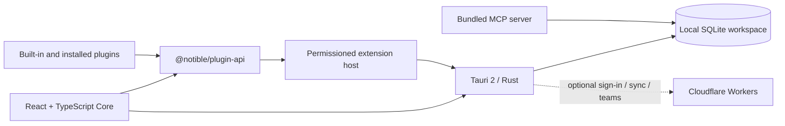

# Notible 0.97.0

[](LICENSE)
[](package.json)
[](https://szymonjankiewicz.com/p/notible)

Notible is a local-first workspace for notes, projects, tasks, and structured knowledge. Its compact Core owns your data, navigation, search, and editing; a public plugin system adds boards, planning, automation, whiteboards, finance, calendars, themes, and more.

## Screenshots



| Writing and structure | Boards and tables |
| --- | --- |
|  |  |



## Download

Download the current Windows release from the **[official Notible page](https://szymonjankiewicz.com/p/notible)**, or see [GitHub Releases](../../releases).

Notible ships as Windows x64 NSIS (`.exe`) and MSI installers (about 44 MB). Installed builds include an automatic updater which verifies a signed update manifest.

## Core features

Notible is useful before any optional domain plugin is loaded. Core provides:

- a Markdown editor with headings, lists, task checkboxes, quotes, tables, code blocks with formatting tools, images, a `/` insert menu, and print / save as PDF;
- `[[wiki links]]` between notes, with backlinks and word count below each note;
- a nested tree of workspaces, folders, projects, and notes with drag-to-reorder, recently opened notes, and back navigation (Alt+Left);
- workspace search (Ctrl+K), quick create (Ctrl+N), interface zoom (Ctrl+= / Ctrl+-), and in-app help (F1);
- SQLite persistence with migrations, per-note version history, trash, backups and restore (Settings → Recovery), and media storage;
- sync plumbing (outbox, tombstones) and a view for reviewing and resolving sync conflicts;
- English and Polish UI, installable language packs, and light/dark themes;
- the extension host: manifests, permissions, loading, lifecycle, and registered commands, views, settings, editor extensions, and UI slots;
- single note / project export and import, also in the minimal Core-only build.

See the [Core/plugin boundary](docs/CORE_PLUGIN_BOUNDARY.md) and completed [migration matrix](docs/CORE_PLUGIN_MIGRATION_MATRIX.md).

### Built-in plugins

The standard app bundles plugins through the same public contract available to third-party authors:

- **Properties** — typed fields and schema-driven property editing.
- **Work Models** — projects, tasks, issues, milestones, cycles, and releases.
- **Views** — saved board, table, list, gallery, and calendar views.
- **Planning** — dependency-aware timelines and Gantt planning.
- **Automations** — local triggers, conditions, actions, schedules, and history.
- **Finance** — budgets, costs, vendors, time entries, and forecasting.
- **Calendar** — dated work beside optional Google or Outlook calendars.
- **Whiteboard** — freeform cards, shapes, linked notes, tables, and connectors.
- **Queries** — live, self-updating lists embedded in notes.
- **Editor Extensions** — highlighted code, diffs, Mermaid, and prose tools.
- **Typewriter** — manuscripts, scenes, targets, and story references.
- **Search** — an additional filtered search surface and backlink tools.
- **Import / Export** — portable JSON transfer for a note or project.
- **Themes** — installable themes; Daylight and Midnight are included.

The in-app market can install more plugins. Themes and language packs use their own package formats.

## Architecture

Notible uses Tauri 2 and Rust for native services and SQLite persistence, with a React 19 and TypeScript frontend. Core and plugins communicate through the versioned public [`@notible/plugin-api`](packages/) contract.



Plugin manifests declare data, media, network, notification, editor, and workspace UI permissions. The host validates packages and mediates native access; untrusted code requires explicit approval.

The bundled [`mcp-server/`](mcp-server/) lets compatible AI clients work with Notible through a constrained tool surface. Optional Cloudflare Workers in [`server/`](server/) and [`services/notible-teams/`](services/notible-teams/) provide sign-in, synchronization, and team services; they are not required for local use.

On Windows, the local SQLite workspace and managed files live in the app data directory for `com.notible.app` (`%APPDATA%\com.notible.app`). Sync is optional, and the desktop app works without an account.

## Build from source

Prerequisites: Node.js 22.6+ (24 LTS recommended; the checks use `--experimental-strip-types`), npm, stable Rust/Cargo, Git, and the [Tauri 2 prerequisites for Windows](https://v2.tauri.app/start/prerequisites/) (Microsoft C++ Build Tools and WebView2).

```powershell
npm install
npm --prefix mcp-server ci --omit=dev
npm run setup:node-runtime
Copy-Item .cargo/config.toml.example .cargo/config.toml
npm run tauri:dev
```

`mcp-server` has its own production dependencies, which the installer bundles; install them with Node 24 so `better-sqlite3` matches the bundled runtime (ABI 137). `setup:node-runtime` downloads that runtime (Node v24.21.0, hash-checked). The Cargo configuration supplies build-time environment placeholders. Google OAuth credentials are optional: without them, the local workspace, editor, plugins, backups, MCP server, and other offline features work normally; Google sign-in and Google-backed sync do not.

Build Windows installers with `npm run tauri:build`. The bundle also produces signed updater artifacts, so set `TAURI_SIGNING_PRIVATE_KEY` (and `TAURI_SIGNING_PRIVATE_KEY_PASSWORD`) to a key of your own first, e.g. one made with `npx tauri signer generate -w <path>`. Your builds will not match the official update feed's public key, so they won't auto-update from it. Focused commands include `npm run build:core`, `npm run tauri:core:dev`, and `npm run tauri:core:build`. Run `npm test` for the full suite.

## Repository layout

```text
src/                      React/TypeScript Core UI and product integration
src-tauri/                Tauri 2 Rust app, SQLite, and native services
packages/                 Public plugin API and supporting packages
plugins/builtin/          Built-in plugins loaded through the public API
plugins/                  Additional first-party plugin packages
mcp-server/               Bundled Model Context Protocol server
server/                   Optional sign-in, market, and sync services
services/notible-teams/   Optional team collaboration service
examples/                 Example plugins and integrations
docs/                     Architecture, authoring, and product docs
scripts/                  Checks, packaging, demo, and sandbox automation
```

## Extend Notible

- Start with the [plugin authoring guide](docs/PLUGIN_AUTHORING.md) and [plugin API reference](docs/plugin-api/).
- Browse [`examples/`](examples/) for complete extension projects.
- Create visual packages with [Theme packs](docs/THEME_PACKS.md).
- Translate the application with [Language packs](docs/LANGUAGE_PACKS.md).

## License

Notible is released under the [MIT License](LICENSE). Bundled third-party components are listed in [THIRD_PARTY_NOTICES.md](THIRD_PARTY_NOTICES.md).
