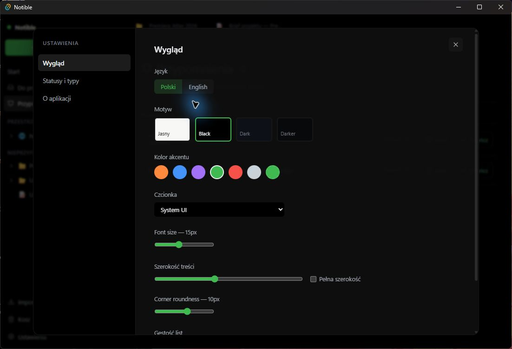

# Notible 0.7.0 — podręcznik użytkownika

## 1. Czym jest Notible

Notible jest miejscem, w którym pomysł może płynnie przejść od luźnej notatki do zaplanowanej i rozliczonej pracy. W jednej lokalnej aplikacji można pisać, gromadzić wiedzę, prowadzić zadania i problemy, planować kamienie milowe, śledzić wydania, kontrolować budżet oraz rejestrować czas.

Najważniejsza zasada brzmi: **ta sama informacja może być oglądana na różne sposoby, ale nie trzeba jej przepisywać**. Zadanie widoczne na liście może pojawić się także na tablicy Kanban, w kalendarzu i na osi czasu. Notatkę można połączyć z projektem, decyzją i konkretnym zadaniem.

Notible najlepiej sprawdza się jako:

- osobista baza wiedzy i notatnik;
- centrum pracy nad jednym lub wieloma projektami;
- rejestr decyzji, spotkań i ustaleń;
- narzędzie do codziennego przeglądu zadań;
- lokalny pulpit budżetu, kosztów, przychodów i czasu pracy.

## 2. Pierwsze uruchomienie

1. Uruchom instalator wersji 0.7.0 i przejdź przez standardową instalację systemu Windows.
2. Otwórz Notible z menu Start lub skrótu utworzonego przez instalator.
3. Jeżeli interfejs nie jest po polsku, wybierz **Ustawienia**, przejdź do sekcji wyglądu i ustaw język **Polski**.
4. W tej samej sekcji wybierz motyw, kolor akcentu, krój i rozmiar pisma, szerokość treści oraz gęstość interfejsu.
5. Wróć do ekranu **Start**. Możesz rozpocząć od pustej notatki albo utworzyć folder lub projekt.

> Notible zapisuje pracę lokalnie. Nie trzeba ręcznie naciskać przycisku „Zapisz” po każdej zmianie. Mimo to warto regularnie wykonywać kopię ważnych danych i zachowywać eksporty kluczowych projektów.

W polskim interfejsie wersji 0.7.0 część nazw funkcji specjalistycznych pozostaje po angielsku, na przykład Canvas, Table, Kanban, Form, Triage albo Backlog. W tym podręczniku używane są etykiety widoczne w aplikacji, aby łatwo było odnaleźć właściwy przycisk.

## 3. Jak uporządkowana jest praca

### Przestrzeń

Przestrzeń jest najwyższym poziomem organizacji. Można przeznaczyć osobne przestrzenie na pracę, życie prywatne, naukę lub klientów. Kliknij znak **+** przy nagłówku **PRZESTRZENIE**, aby utworzyć kolejną.

### Folder

Folder grupuje powiązane elementy. Dobrymi folderami są na przykład „Spotkania”, „Badania”, „Materiały marketingowe” albo nazwa klienta. Folder może zawierać dalsze elementy, dzięki czemu da się zbudować przejrzyste drzewo.

### Notatka

Notatka jest swobodną stroną do pisania. Może zawierać nagłówki, listy, checklisty, tabele, cytaty, kod, wyróżnione komunikaty, linki, obrazy, układ kolumnowy i osadzone widoki.

### Zadanie i problem

Zadanie opisuje pracę do wykonania. Problem służy do rejestrowania błędu, ryzyka albo przeszkody wymagającej rozwiązania. Oba typy mogą mieć status, priorytet, terminy, tagi, relacje i dodatkowe właściwości.

### Projekt

Projekt łączy opis, właściwości, zadania, problemy, plan, oś czasu, finanse, aktualizacje, pliki i historię aktywności. To najlepszy wybór, gdy praca ma cel, termin, właściciela i kilka etapów.

## 4. Orientacja w oknie aplikacji

Po lewej stronie znajduje się pasek nawigacyjny:

- **Nowa notatka** — szybkie tworzenie nowego elementu;
- ikona lupy — wyszukiwanie i paleta poleceń;
- **Start** — ostatnio używane strony i skróty do typowych elementów;
- **Do przeglądu** — skrzynka dla spraw wymagających późniejszego uporządkowania;
- **Przypomnienia** — zadania i notatki wymagające uwagi w określonym czasie;
- drzewo przestrzeni, folderów i projektów;
- **Importuj**, **Kosz** i **Ustawienia**.

Otwierane strony pojawiają się jako karty u góry. Dzięki temu można przełączać się między projektem, briefem i notatkami ze spotkania bez ponownego szukania ich w drzewie.

Najczęściej używany element można dodać do ulubionych z menu dostępnego obok jego nazwy w drzewie. Ulubione traktuj jako krótką listę bieżących punktów wejścia, nie jako drugie archiwum. Karty zamykaj, gdy kończysz dany kontekst; zamknięcie karty nie usuwa strony.

## 5. Tworzenie pierwszej notatki

### Szybka notatka krok po kroku

1. Kliknij **Nowa notatka**.
2. Wybierz typ **Notatka**.
3. Wpisz tytuł, na przykład „Pomysły na kampanię”.
4. Opcjonalnie dodaj krótki opis i wybierz folder albo projekt nadrzędny.
5. Zatwierdź utworzenie strony.
6. Kliknij obszar treści i zacznij pisać.

### Pisanie i formatowanie

W pustym wierszu wpisz znak `/`, aby otworzyć menu bloków. Dostępne są między innymi:

- nagłówki pierwszego, drugiego i trzeciego poziomu;
- lista punktowana, numerowana oraz lista z polami wyboru;
- cytat, blok kodu i separator;
- tabela oraz wyróżniony komunikat;
- link i obraz;
- układ dwóch lub trzech kolumn;
- osadzona tabela, tablica, kalendarz, lista albo pulpit.

Menu można przeszukiwać, wpisując dalszą część nazwy polecenia. Najpierw buduj strukturę nagłówkami, a dopiero później dodawaj szczegóły. Długa notatka pozostaje wtedy czytelna.

### Szablony

Podczas tworzenia elementu można skorzystać z gotowego punktu wyjścia:

- standardowe zadanie;
- raport błędu;
- brief projektu;
- notatki ze spotkania;
- rejestr decyzji.

Szablon nie jest formularzem, którego trzeba trzymać się bezwzględnie. Po utworzeniu strony każdy fragment można dopasować do własnej pracy.

### Tagi, właściwości i relacje

Tag opisuje temat przekrojowo, na przykład `#atlas`, `#marketing` lub `#decyzja`. Właściwości przechowują bardziej uporządkowane dane. Relacje łączą stronę z innymi elementami.

1. Otwórz notatkę.
2. Kliknij **+ Tag** i dodaj jednoznaczne hasło bez zbędnych wariantów.
3. Kliknij **+ Add property**, jeśli potrzebujesz dodatkowego pola.
4. Kliknij **Relacje**, wyszukaj element i wybierz go z listy.
5. Otwórz sekcję relacji, aby przejść bezpośrednio do powiązanej strony.

### Historia wersji i szerokość strony

W prawym górnym rogu strony znajduje się historia wersji oraz ustawienie szerokości. Historia pomaga wrócić do wcześniejszego stanu treści. Szeroki układ jest wygodny dla tabel i pulpitów, a węższy — dla dłuższego tekstu.

## 6. Szybkie wyszukiwanie

Paletę poleceń otworzysz przyciskiem lupy lub skrótem **Ctrl+K**. Zacznij wpisywać tytuł, a następnie otwórz wynik bez przechodzenia przez drzewo folderów.

Wyszukiwanie można zawężać filtrami:

- `type:` — typ elementu;
- `tag:` — tag;
- `in:` — miejsce lub kontener;
- `status:` — status pracy.

Paleta pozwala także szybko rozpocząć tworzenie notatki, zadania lub problemu. Jest to najszybsza metoda pracy, kiedy pamiętasz nazwę lub fragment tytułu.

## 7. Skrzynka „Do przeglądu”

Skrzynka służy do przechwytywania spraw, których nie chcesz porządkować w chwili zapisu. Zamiast przerywać pracę, dodaj element do przeglądu i wróć do niego podczas codziennego porządkowania.

### Codzienny przegląd krok po kroku

1. Otwórz **Do przeglądu**.
2. Przeczytaj pierwszy element i zdecyduj, czym naprawdę jest.
3. Nadaj mu właściwy status, priorytet i termin.
4. Przypisz projekt albo pozostaw go bez projektu, jeśli jest osobisty.
5. Dodaj tag ułatwiający późniejsze odnalezienie.
6. Przejdź do następnego elementu, aż skrzynka będzie pusta.

## 8. Przypomnienia i zadania cykliczne

Widok **Przypomnienia** zbiera elementy wymagające uwagi. Najbardziej praktyczny sposób użycia to ustawienie przypomnienia przy zadaniu, którego nie chcesz stale widzieć na głównej liście.

### Ustawienie przypomnienia

1. Otwórz zadanie lub notatkę.
2. Dodaj albo edytuj właściwość przypomnienia.
3. Wybierz datę i godzinę.
4. Wróć do **Przypomnienia**, aby sprawdzić, czy element pojawił się we właściwej grupie.
5. Po wykonaniu pracy oznacz element jako ukończony albo ustaw późniejszy termin.

Zadania powtarzalne wykorzystuj do czynności takich jak cotygodniowy raport, comiesięczna kontrola kosztów lub przegląd kampanii. Ustal rytm, datę następnego wykonania i zakończ bieżące wystąpienie — Notible może przygotować kolejne zgodnie z regułą.

## 9. Widoki tej samej pracy

W folderze, projekcie lub innym kontenerze można przełączać układ bez tworzenia kopii danych:

- **Canvas** — swobodne rozłożenie elementów i relacji;
- **List** — szybki, zwarty przegląd;
- **Table** — praca na wielu właściwościach jednocześnie;
- **Kanban** — kolumny odpowiadające statusom;
- **Calendar** — elementy rozmieszczone według dat;
- **Form** — formularz do przyjmowania ujednoliconych zgłoszeń.

### Widok zapisany

Kliknij **+ New view**, nadaj nazwę i skonfiguruj układ, filtr oraz sortowanie. Zamiast ciągle odtwarzać te same ustawienia, możesz mieć na przykład widoki „Moje zadania”, „Pilne w tym tygodniu” i „Zakończone”.

### Filtry i sortowanie

Dobry filtr odpowiada na jedno pytanie. Przykłady:

- zadania o wysokim priorytecie, których termin przypada w tym tygodniu;
- problemy ze statusem „Blocked”;
- elementy oznaczone tagiem `marketing`;
- zadania przypisane do konkretnej osoby.

Sortowanie stosuj po filtrze: najpierw ogranicz zakres, a później ułóż wyniki według terminu, priorytetu lub nazwy.

### Tabela i pola zaawansowane

Tabela pozwala dodawać kolumny takie jak tekst, liczba, wybór, data, osoba, czas trwania, postęp, relacja, identyfikator, formuła, podsumowanie relacji lub akcja. Formuły służą do bezpiecznych obliczeń na danych, a podsumowania relacji — do agregowania informacji z powiązanych elementów.

### Automatyzacje i formularze

Przycisk **Automatyzacje** otwiera reguły dla powtarzalnych reakcji. Reguła składa się z wyzwalacza, opcjonalnych warunków oraz jednej lub kilku akcji. Może reagować na utworzenie rekordu, zmianę właściwości, nadejście daty albo uruchomienie ręczne.

Przykład dla zespołu wsparcia: gdy priorytet zgłoszenia zmieni się na **Pilny**, Notible może ustawić status **Otwarte**, dodać wpis do historii i utworzyć przypomnienie. Przed włączeniem reguły użyj opcji **Przetestuj na przykładowym rekordzie**. Wynik testu informuje, czy rekord spełnia warunki i jakie akcje zostałyby wykonane. Zakładka **Dziennik wykonań** pokazuje powodzenia, pominięcia i błędy wraz z ich przyczyną.

Reguły związane z datą uruchomisz przyciskiem **Uruchom reguły terminów**. Dla tego samego rekordu dana reguła daty wykona się najwyżej raz dziennie. Jedno zdarzenie ma również limit akcji, który chroni przed przypadkową pętlą automatyzacji.

Formularz jest przydatny, gdy wiele osób lub procesów ma dostarczać dane w tej samej strukturze, na przykład zgłoszenie błędu, pomysł lub prośbę o materiał.

### Pakiety pracy

Pakiety pracy pozwalają rozpocząć od kompletnego, spójnego przepływu zamiast budować wszystkie typy, widoki i reguły od zera. Otwórz **Ustawienia → Pakiety pracy** i wybierz jeden z czterech zestawów:

- **Support Desk** — zgłoszenia, klienci, SLA, eskalacje i baza wiedzy;
- **Development** — błędy, zadania techniczne, QA i praca zespołu deweloperskiego;
- **Project Delivery** — realizacja projektu z planowaniem, terminami i odpowiedzialnością;
- **Praca osobista i operacyjna** — codzienne zadania, sprawy administracyjne i notatki robocze.

Przed zastosowaniem pakietu zdecyduj, czy chcesz dodać rekordy demonstracyjne. Są przydatne do nauki i prezentacji, ale nie są wymagane. Instalacja rozpoczyna się od kopii bezpieczeństwa i nie usuwa istniejących rekordów ani własnych widoków. Ponowne zastosowanie pakietu odtwarza zarządzane widoki i reguły, zachowując Twoje dane.

Po instalacji nowa przestrzeń pojawia się na pasku bocznym. Otwórz ją i przechodź między przygotowanymi widokami. Na przykład Support Desk zawiera widoki nowych zgłoszeń, obsługi, terminów SLA, formularza zgłoszeniowego i bazy wiedzy oraz gotowe reguły automatyzacji.

### Pulpity i osadzone widoki

Pulpit zbiera wybrane informacje w jednym miejscu. Można używać kart statystycznych, wykresów kołowych i słupkowych, list, tabel oraz zestawień nadchodzących elementów. Widżety konfiguruj pod decyzję, którą mają wspierać — na przykład „ile zadań jest zablokowanych?”, „jak rozkładają się statusy?” albo „co ma termin w tym tygodniu?”.

Osadzony widok wewnątrz notatki jest przydatny w briefie, raporcie lub stronie zespołu. Wpisz `/` i wybierz osadzaną tabelę, tablicę, kalendarz, listę albo pulpit. Dzięki temu opis i aktualne dane mogą znajdować się obok siebie, bez ręcznego przepisywania liczb.

## 10. Prowadzenie projektu od początku do końca

Projekt „Premiera Atlas 2026” pokazuje zalecany sposób pracy.

### Przegląd

Zakładka **Przegląd** odpowiada na pytania: po co robimy projekt, kto za niego odpowiada, jaki jest termin i kondycja? Uzupełnij przede wszystkim:

- krótkie podsumowanie;
- status i kondycję;
- priorytet;
- datę rozpoczęcia i datę docelową;
- właściciela, lidera i zespół;
- częstotliwość aktualizacji.

Liczby w sekcji postępu są zbiorczym obrazem zawartości projektu. Przed prezentacją wyników zawsze sprawdź widok zadań i problemów, jeśli potrzebujesz dokładnego rozbicia.

### Zadania i problemy

Zakładki **Zadania** i **Problemy** używają widoków opisanych wcześniej. Na tablicy Kanban można łatwo zauważyć, gdzie praca się zatrzymuje. Przeciąganie karty między kolumnami zmienia jej status.

### Planowanie

W zakładce **Planowanie** występują trzy poziomy:

- **kamień milowy** — ważny rezultat lub punkt kontrolny;
- **cykl** — ograniczony czasowo fragment pracy z pojemnością i prędkością;
- **wydanie** — paczka pracy dostarczana jako określona wersja.

#### Dodawanie elementu planu

1. Otwórz **Planowanie**.
2. Wybierz rodzaj elementu z listy.
3. Wpisz nazwę i kliknij **Dodaj**.
4. Ustaw datę lub zakres dat, status oraz — dla cyklu — pojemność.
5. Powiąż zadania, aby postęp wynikał z rzeczywistej pracy.
6. Dla wydania uzupełnij numer wersji.
7. Gdy wydanie jest gotowe, użyj **Eksportuj changelog**, aby przygotować listę zmian.

### Oś czasu

Oś czasu łączy daty zadań, cykli i kamieni milowych. Kolory pomagają odróżnić pracę planowaną, aktywną, ukończoną i zablokowaną. Zmień widoczny zakres dat lub wróć przyciskiem **Dzisiaj** do bieżącego okresu.

### Aktualizacje

Aktualizacje są krótkimi raportami o stanie projektu. Regularnie zapisz:

1. co udało się zakończyć;
2. co dzieje się teraz;
3. jakie ryzyko lub blokada wymaga uwagi;
4. jaki jest następny krok.

Konsekwentny rytm aktualizacji jest bardziej wartościowy niż bardzo długi raport publikowany sporadycznie.

### Pliki

Zakładka **Pliki** pozwala połączyć projekt z folderem na dysku i przeglądać materiały w jednym kontekście. Podgląd jest przeznaczony do odczytu; edycję wykonuj w programie właściwym dla danego typu pliku. Nie przenoś powiązanego folderu bez ponownego wskazania go w projekcie.

### Aktywność

Zakładka **Aktywność** pokazuje chronologię zmian. Korzystaj z niej, gdy chcesz ustalić, co zmieniło się od ostatniego przeglądu lub odtworzyć kolejność decyzji.

## 11. Finanse projektu

Moduł finansowy łączy planowany budżet z kosztami, przychodami i czasem pracy. Dane finansowe są lokalne i można oznaczyć je jako prywatne.

### Konfiguracja budżetu

1. Otwórz projekt i wybierz **Finanse**.
2. W zakładce **Przegląd** ustaw walutę bazową.
3. Wpisz budżet planowany oraz zatwierdzony.
4. Dodaj środki początkowe, jeśli chcesz obserwować dostępny zapas.
5. Ustal procent, przy którym ma pojawić się alert.
6. Wybierz widoczność finansów. Ustawienie prywatne jest właściwe dla danych wrażliwych.

Pulpit oblicza między innymi koszt rzeczywisty, przychód, marżę, miesięczne wydatki, prognozę kosztu końcowego, odchylenie budżetu i prognozę kosztów cyklicznych.

### Dodawanie transakcji

1. Przejdź do **Finanse → Transakcje**.
2. Wpisz nazwę pozycji.
3. Wybierz koszt albo przychód.
4. Podaj kwotę i datę.
5. Dodaj kategorię oraz dostawcę lub kontrahenta.
6. Ustaw stan pozycji, na przykład planowana, zatwierdzona lub opłacona.
7. Opcjonalnie wskaż ścieżkę do załącznika.
8. Kliknij **Dodaj**.

### Ewidencja czasu

W zakładce **Ewidencja czasu** dodawaj osobę, datę, liczbę godzin, stawkę kosztową i — jeżeli praca jest rozliczana klientowi — stawkę rozliczeniową. Oznaczenie czasu jako rozliczalnego wpływa na obliczenia przychodu.

### Import i eksport

Finanse można importować i eksportować w formatach CSV oraz XLSX. Przed importem sprawdź walutę, format dat i znaczenie kwot. Po imporcie porównaj sumę kontrolną z plikiem źródłowym. Eksport zachowaj jako okresową kopię raportową.

## 12. Importowanie istniejących materiałów

Przycisk **Importuj** w pasku bocznym pozwala wprowadzić istniejące pliki Markdown oraz dane tabelaryczne CSV/TSV.

### Import Markdown

1. Kliknij **Importuj**.
2. Wybierz plik Markdown.
3. Wskaż miejsce docelowe.
4. Po imporcie sprawdź nagłówki, listy, linki i obrazy.
5. Dodaj tagi i relacje, aby nowa strona stała się częścią bazy wiedzy.

### Import CSV lub TSV

1. Przygotuj pierwszy wiersz jako nazwy kolumn.
2. Ujednolić daty i wartości wyboru przed importem.
3. Wybierz plik w oknie importu.
4. Sprawdź mapowanie kolumn.
5. Zaimportuj niewielką próbkę, a dopiero później pełny zestaw.

## 13. Ustawienia i personalizacja

W **Ustawieniach** można dopasować wygląd i słownik pracy:

- język polski lub angielski;
- motyw jasny, czarny, ciemny lub jeszcze ciemniejszy;
- kolor akcentu;
- krój i rozmiar pisma;
- szerokość treści;
- promień zaokrągleń i gęstość układu;
- dostępne statusy oraz typy elementów.

Zmiany statusów i typów wpływają na cały sposób pracy. Przed usunięciem lub przemianowaniem wartości sprawdź, jak są używane w istniejących widokach i filtrach.

## 14. Usuwanie i odzyskiwanie

Usunięty element trafia do **Kosza**. To bezpieczniejszy etap pośredni niż natychmiastowe trwałe kasowanie.

1. Otwórz **Kosz**.
2. Znajdź element po tytule.
3. Przywróć go, jeżeli został usunięty omyłkowo.
4. Trwale opróżniaj kosz dopiero po sprawdzeniu, że nie zawiera potrzebnych materiałów.

Relacje do usuniętych elementów mogą stracić użyteczny kontekst, dlatego przy większym porządkowaniu najpierw wykonaj eksport lub kopię.

## 15. Łączenie i obliczanie danych w wersji 0.10.0

W tabeli możesz budować informacje pochodne bez przepisywania wartości między
rekordami. Zacznij od kolumny typu **Relacja**. Wybierz, czy pojedynczy rekord
może wskazywać jeden czy wiele rekordów, opcjonalnie ogranicz typ elementu
docelowego i podaj czytelną nazwę relacji po drugiej stronie.

Kolumna **Wyszukiwanie powiązanej wartości** pokazuje właściwość rekordu
połączonego relacją. Przykładowo zgłoszenie supportowe może wyświetlać nazwę
klienta, a projekt — tytuły powiązanych zadań. Wartość nadal pochodzi z rekordu
źródłowego, dlatego jej poprawienie jest od razu widoczne wszędzie.

Kolumna **Podsumowanie** agreguje rekordy powiązane. Dostępne są: liczba,
suma, średnia, minimum, maksimum, najwcześniejsza lub najpóźniejsza data oraz
procent rekordów spełniających warunek. Dzięki temu można między innymi policzyć
łączny nakład pracy, średni czas obsługi albo udział zamkniętych zgłoszeń.

### Jak utworzyć pole wyliczane

1. Otwórz tabelę i wybierz **Dodaj kolumnę**.
2. Nadaj kolumnie nazwę i wybierz typ **Formuła**.
3. Wpisz działanie, odwołując się do pól w nawiasach klamrowych, na przykład
   `{estimate} * {rate}`. Przyciski pod edytorem wstawiają dostępne pola.
4. Wybierz **Obliczaj na żądanie**, aby zawsze pokazywać aktualny wynik, albo
   **Utrwalaj wynik**, gdy wartość ma zostać zapisana w rekordzie.
5. Zapisz kolumnę. Jeśli formuła jest niepełna lub wskazuje brakujące pole,
   tabela pokaże błąd tylko w tej komórce i pozwoli dalej edytować pozostałe dane.

### Nazwane miary i zależności

W tabeli wybierz **Model danych**. W sekcji nazwanych miar możesz utworzyć
wskaźnik używany dla całego zbioru, na przykład `COUNT()`, `SUM({amount})`,
`AVG({resolution_time})` albo `COUNTIF({status}, "done")`. Obok miary widoczny
jest jej bieżący wynik. Dolna sekcja pokazuje, od których pól zależą formuły,
lookupy i podsumowania; ułatwia to zrozumienie, skąd pochodzi wartość.

### Elastyczna tablica Kanban

Kanban osadzony w przeglądzie projektu wykorzystuje całą przestrzeń aż do
panelu **Właściwości**. Kolumny rozszerzają się razem z oknem. W wąskim oknie
panel właściwości przechodzi nad treść, a sama tablica zachowuje użyteczną
szerokość kolumn i przewija się poziomo wewnątrz własnego obszaru — bez
rozszerzania całej strony.

## 16. Praktyczne przepisy

### Od pomysłu do zaplanowanego zadania

1. Zapisz pomysł w **Do przeglądu**, nie przerywając bieżącej pracy.
2. Podczas przeglądu zmień go w zadanie.
3. Przypisz projekt, priorytet i termin.
4. Dodaj relację do briefu lub notatki źródłowej.
5. Umieść zadanie w cyklu i, jeśli ma znaczenie dla dostawy, w wydaniu.
6. Śledź je na Kanbanie oraz osi czasu.

### Dobre notatki ze spotkania

1. Utwórz stronę z szablonu **Notatki ze spotkania**.
2. Na początku wpisz cel, datę i uczestników.
3. Oddziel przebieg rozmowy od decyzji.
4. Każde zobowiązanie zapisz jako zadanie z właścicielem i terminem.
5. Połącz notatkę z projektem i zadaniami.
6. Na końcu dopisz termin kolejnego przeglądu.

### Rejestr decyzji

1. Użyj szablonu **Rejestr decyzji**.
2. Opisz kontekst i rozważane warianty.
3. Zapisz jednoznaczną decyzję oraz powód.
4. Wymień konsekwencje i działania następcze.
5. Dodaj tag `decyzja` i relacje do projektu oraz dotkniętych zadań.

### Cotygodniowy przegląd projektu

1. Opróżnij **Do przeglądu**.
2. Sprawdź zaległe i nadchodzące przypomnienia.
3. Przejrzyj Kanban od prawej do lewej: najpierw ukończone, potem zablokowane i trwające.
4. Porównaj cykl z pojemnością i prędkością.
5. Sprawdź oś czasu pod kątem nakładających się terminów.
6. Skontroluj koszty i wpisy czasu.
7. Opublikuj krótką aktualizację projektu.

## 17. Dobre nawyki doświadczonego użytkownika

- Jedna strona powinna mieć jeden wyraźny cel.
- Tytuły zapisuj tak, aby były zrozumiałe także po kilku miesiącach.
- Ogranicz liczbę tagów; unikaj synonimów oznaczających to samo.
- Nie kopiuj treści między stronami — twórz relacje.
- Zadanie bez właściciela i terminu jest raczej pomysłem niż zobowiązaniem.
- Status „Blocked” zawsze uzupełnij informacją, czego brakuje i kto może pomóc.
- Datę na osi czasu traktuj jako zobowiązanie planistyczne, nie ozdobę.
- Aktualizacje projektu pisz regularnie i krótko.
- Dane finansowe wprowadzaj w jednym rytmie, najlepiej co tydzień.
- Ważne wydania i budżety okresowo eksportuj.

## 18. Skrócona lista możliwości

- notatki z rozbudowanym edytorem blokowym;
- szablony notatki spotkania, decyzji, briefu, zadania i błędu;
- tagi, właściwości, relacje, linki zwrotne i historia wersji;
- przestrzenie, foldery, projekty, karty i ulubione;
- wyszukiwanie z filtrami i paleta poleceń;
- skrzynka **Do przeglądu**, przypomnienia i zadania cykliczne;
- widoki Canvas, List, Table, Kanban, Calendar i Form;
- zapisane widoki, filtry, sortowanie, automatyzacje i formularze;
- zadania, problemy, kamienie milowe, cykle, wydania i changelog;
- oś czasu, aktualizacje, aktywność i powiązany folder plików;
- budżet, transakcje, ewidencja czasu, prognozy oraz CSV/XLSX;
- polski i angielski interfejs oraz rozbudowane opcje wyglądu;
- import Markdown, CSV i TSV, eksport danych oraz kosz.

## 19. Co dalej

Najlepszym pierwszym ćwiczeniem jest przejście gotowego [scenariusza demonstracyjnego](SCENARIUSZ_DEMO.md). Jego dane opisuje [pakiet „Premiera Atlas 2026”](PAKIET_DEMO.md). Po prezentacji skopiuj ten sposób organizacji do jednego prawdziwego projektu, zamiast od razu przebudowywać cały swój system pracy.
