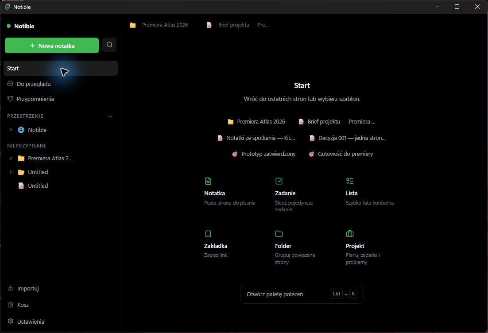
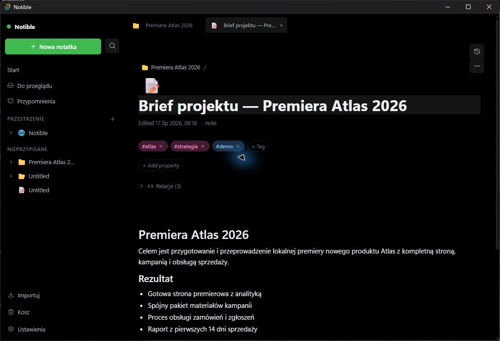
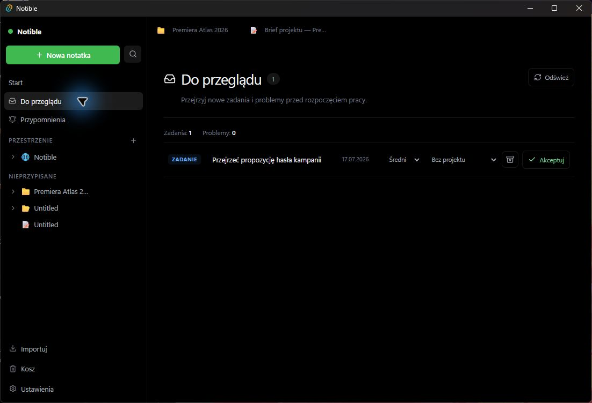
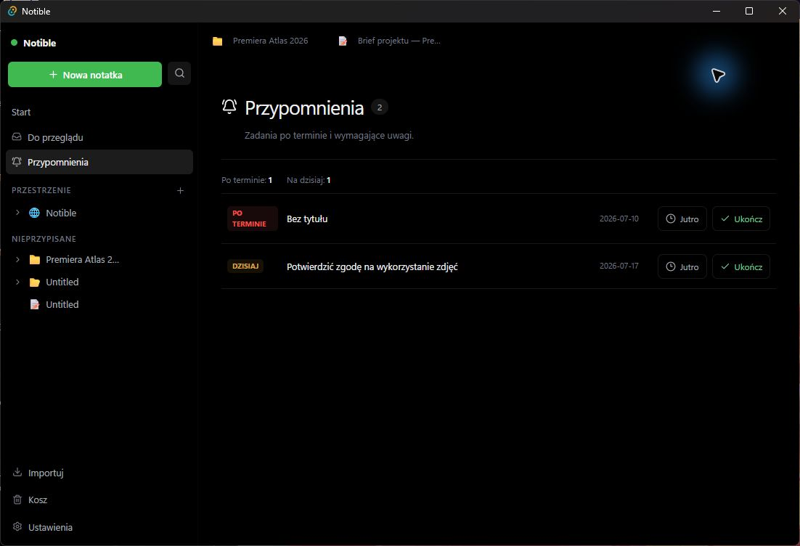
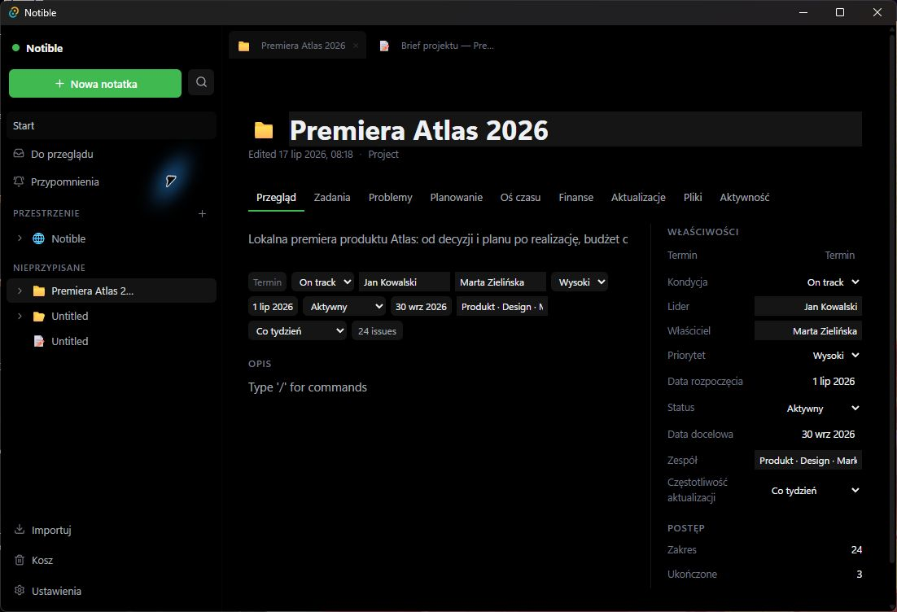
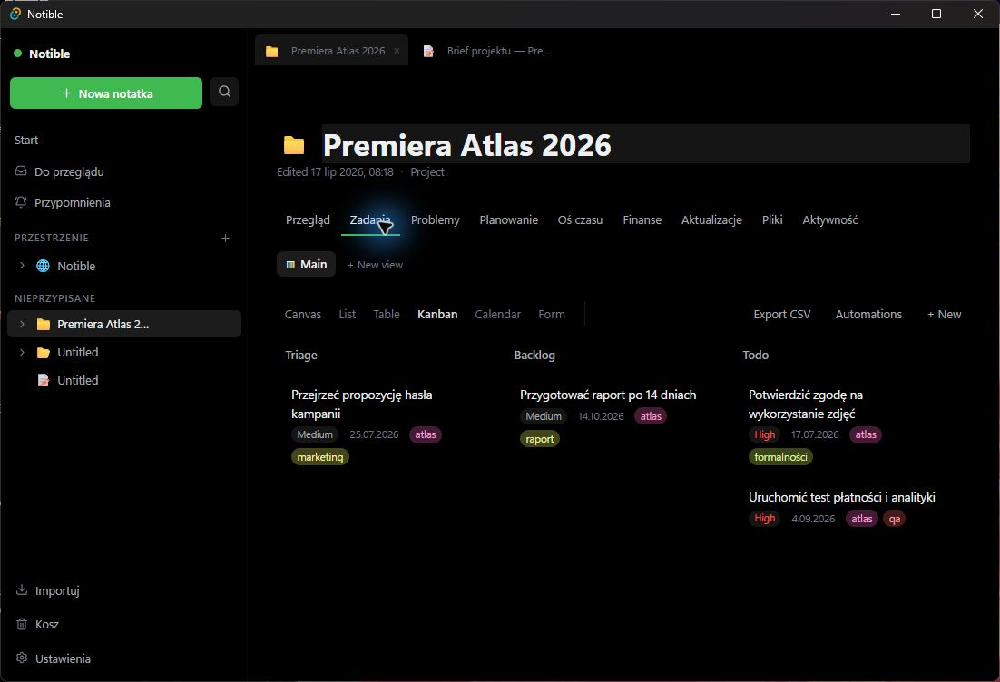
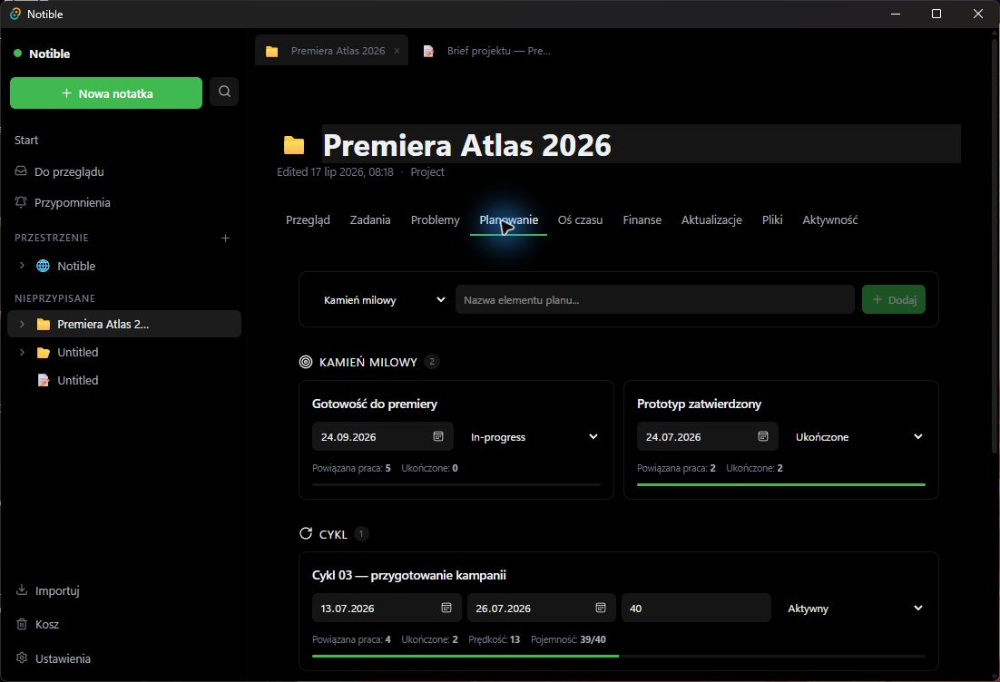
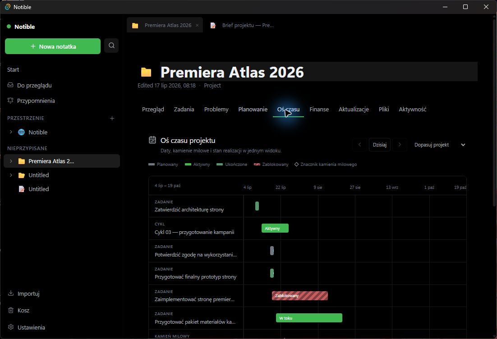
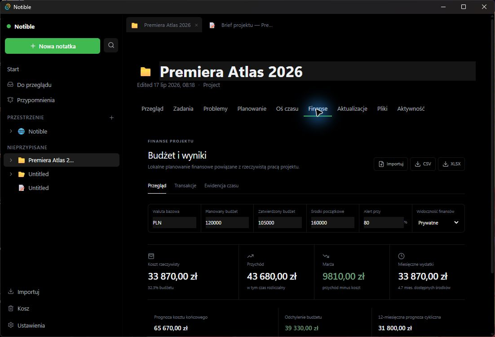
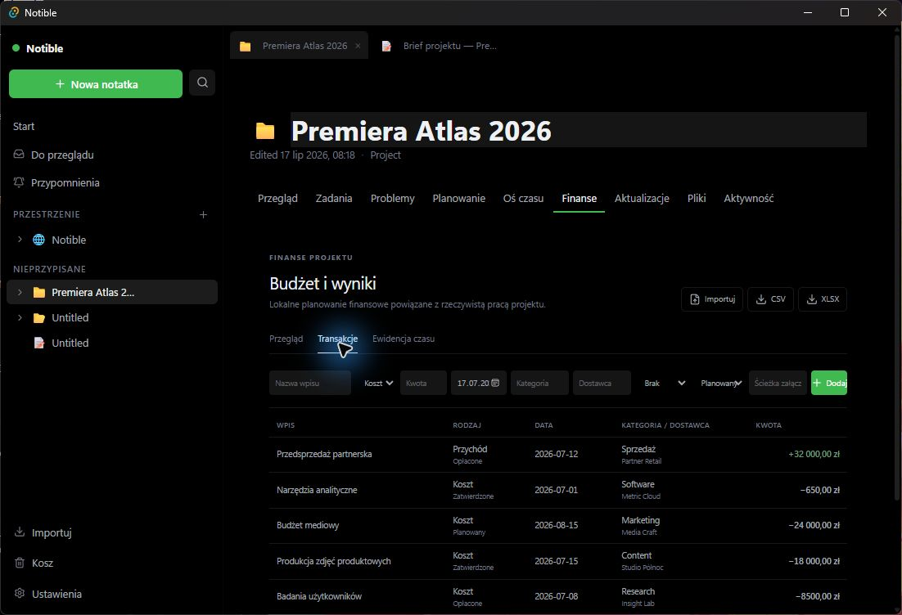

# Notible 0.7.0 — scenariusz prezentacji

## Cel prezentacji

Ten scenariusz pokazuje Notible jako spójne środowisko pracy: od zapisu wiedzy, przez realizację zadań, po planowanie wydania i kontrolę finansów. Pełna wersja trwa około **35 minut**. Wariant skrócony można zamknąć w 15 minut, pomijając fragmenty oznaczone jako opcjonalne.

Przykładową historią jest lokalna premiera produktu **Atlas 2026**. Prezentujący występuje jako osoba prowadząca projekt, która chce pokazać nie pustą aplikację, lecz żywy system używany od kilku tygodni.

## Przygotowanie przed spotkaniem

1. Uruchom Notible 0.7.0 co najmniej pięć minut wcześniej.
2. Ustaw język polski i czytelny ciemny motyw.
3. Ustaw okno na około **1100 × 750 px**. Taki rozmiar dobrze mieści panel boczny i treść, a tekst pozostaje czytelny podczas udostępniania ekranu.
4. Sprawdź, czy projekt **Premiera Atlas 2026** jest widoczny na stronie Start.
5. Otwórz wcześniej karty projektu i briefu, ale na początku wróć do **Start**.
6. Upewnij się, że w projekcie są zadania, dwa kamienie milowe, jeden cykl, wydanie Atlas 1.0, transakcje i wpisy czasu.
7. Zamknij prywatne programy i wyłącz zbędne powiadomienia systemowe.
8. Nie zmieniaj wartości finansowych podczas prezentacji bez potrzeby — pulpit ma być gotowym, wiarygodnym podsumowaniem.

## Zasada prowadzenia

Najpierw opowiedz problem użytkownika, dopiero potem pokaż funkcję. Nie wyliczaj kolejnych przycisków. Prowadź jedną historię: „mieliśmy pomysł, uporządkowaliśmy decyzje, zaplanowaliśmy pracę, wykryliśmy blokadę i wiemy, jak wpływa to na termin oraz budżet”.

## Przebieg pełny — około 35 minut

### 0:00–2:30 — otwarcie i strona Start

**Powiedz:**

> Notible jest moim lokalnym centrum projektu. Nie rozdzielam notatek, zadań, terminów i budżetu między kilka aplikacji. To nadal lekki notatnik, ale gdy pomysł dojrzewa, mogę prowadzić go aż do wydania.

**Zrób:**

1. Pokaż ekran **Start**.
2. Wskaż przycisk **Nowa notatka**, wyszukiwanie, **Do przeglądu** i **Przypomnienia**.
3. Zwróć uwagę na ostatnio otwierane elementy: projekt, brief, spotkanie, decyzję i kamienie milowe.
4. Wyjaśnij, że strony otwierają się w kartach.

**Rezultat dla widza:** rozumie układ aplikacji i widzi, że demo zawiera realistyczne dane.

### 2:30–6:30 — brief jako źródło wspólnego kontekstu

**Powiedz:**

> Zanim powstała tablica zadań, zapisaliśmy wspólny cel. Dzięki temu zadania nie są oderwaną listą czynności, tylko wynikają z briefu.

**Zrób:**

1. Otwórz **Brief projektu — Premiera Atlas 2026**.
2. Pokaż tytuł, tagi `atlas`, `strategia` i `demo`.
3. Przeczytaj jedno zdanie celu oraz cztery rezultaty.
4. Rozwiń **Relacje** i pokaż, że brief prowadzi do innych elementów.
5. Wskaż checklistę kryteriów sukcesu.
6. Opcjonalnie pokaż ikonę historii wersji i ustawienie szerokości strony.

**Komentarz ekspercki:**

> Tag służy mi do znalezienia tematu w całej bazie, a relacja pokazuje konkretne znaczeniowe połączenie. Nie kopiuję briefu do zadań — łączę je z jednym źródłem.

### 6:30–9:00 — notatka ze spotkania i decyzja

**Zrób:**

1. Z ekranu Start otwórz **Notatki ze spotkania — Kick-off Atlas**.
2. Wskaż sekcje: cel, uczestnicy, ustalenia i działania.
3. Otwórz **Decyzja 001 — jedna strona premierowa**.
4. Pokaż kontekst, rozważane warianty, podjętą decyzję i konsekwencje.

**Powiedz:**

> Notatka odpowiada na pytanie „co omówiliśmy”, a rejestr decyzji — „dlaczego wybraliśmy właśnie tę drogę”. Za trzy miesiące nie muszę odtwarzać argumentów z pamięci.

### 9:00–11:30 — przechwytywanie i codzienny przegląd

**Zrób:**

1. Otwórz **Do przeglądu**.
2. Wybierz „Przejrzeć propozycję hasła kampanii”.
3. Pokaż możliwość ustawienia projektu, statusu, priorytetu, terminu i tagów.
4. Nie zapisuj przypadkowych zmian, jeśli pokaz ma być wielokrotnie powtarzany.
5. Przejdź do **Przypomnienia** i wskaż „Oddzwonić do partnera retail”.

**Powiedz:**

> Skrzynka pozwala mi szybko coś przechwycić, a dopiero później podjąć decyzję. Przypomnienie oddziela moment zapisania sprawy od momentu, w którym chcę się nią zająć.

### 11:30–14:00 — przegląd projektu

**Zrób:**

1. Otwórz projekt **Premiera Atlas 2026**.
2. Zostań na zakładce **Przegląd**.
3. Wskaż opis, status „Aktywny”, kondycję „On track”, priorytet wysoki, terminy i osoby odpowiedzialne.
4. Pokaż częstotliwość aktualizacji „Co tydzień”.

**Powiedz:**

> Ten ekran jest odpowiedzią dla osoby, która ma minutę: jaki jest cel, kto odpowiada, dokąd zmierzamy i czy projekt jest zdrowy.

### 14:00–18:00 — zadania na Kanbanie

**Zrób:**

1. Otwórz **Zadania**.
2. Wybierz **Kanban**, jeżeli inny widok jest aktywny.
3. Wskaż kolejne etapy: Triage, Backlog, Todo, In Progress, Blocked i Done.
4. Znajdź „Zaimplementować stronę premierową” w stanie zablokowanym.
5. Pokaż „Przygotować pakiet materiałów kampanii” w toku i dwa ukończone zadania.
6. Przełącz na krótko **Table** albo **Calendar**, aby udowodnić, że to te same elementy w innym układzie.
7. Wróć do Kanbanu.

**Powiedz:**

> Zmiana widoku nie tworzy drugiej listy. Termin jest przydatny w kalendarzu, status na Kanbanie, a wiele właściwości najłatwiej edytować w tabeli.

### 18:00–22:30 — plan: kamienie milowe, cykl i wydanie

**Zrób:**

1. Otwórz **Planowanie**.
2. Pokaż ukończony kamień milowy „Prototyp zatwierdzony”.
3. Pokaż „Gotowość do premiery” wraz z powiązaną pracą.
4. Wskaż cykl „Cykl 03 — przygotowanie kampanii”, zakres dat, pojemność 40 i prędkość.
5. Pokaż wydanie **Atlas 1.0**, numer **1.0.0** i przycisk **Eksportuj changelog**.

**Powiedz:**

> Zadanie mówi, co robimy. Kamień milowy mówi, jaki rezultat osiągnęliśmy. Cykl ogranicza bieżące zobowiązania, a wydanie zbiera to, co naprawdę dostarczamy.

### 22:30–25:00 — oś czasu i wpływ blokady

**Zrób:**

1. Otwórz **Oś czasu**.
2. Wskaż legendę statusów.
3. Pokaż czerwony, zablokowany odcinek strony premierowej.
4. Porównaj go z aktywnym przygotowaniem materiałów kampanii.
5. Wskaż kamień milowy premiery i zmianę widocznego zakresu dat.

**Powiedz:**

> Kanban pokazuje stan, a oś czasu pokazuje konsekwencję tego stanu. Tutaj od razu widać, czy blokada wchodzi w drogę innemu zadaniu lub kamieniowi milowemu.

### 25:00–27:00 — aktualizacje, pliki i aktywność

**Zrób:**

1. Otwórz **Aktualizacje** i pokaż dwa cotygodniowe wpisy.
2. Otwórz **Pliki** i objaśnij powiązanie lokalnego folderu oraz podgląd tylko do odczytu.
3. Otwórz **Aktywność** i wskaż chronologię zmian.

**Powiedz:**

> Aktualizacja jest komunikatem dla ludzi, pliki są materiałem źródłowym, a aktywność jest śladem tego, co wydarzyło się w systemie.

### 27:00–32:00 — finanse i czas

**Zrób:**

1. Otwórz **Finanse → Przegląd**.
2. Wskaż PLN, budżet planowany 120 000, zatwierdzony 105 000 i środki początkowe 160 000.
3. Pokaż koszt rzeczywisty, przychód, marżę i prognozę końcową.
4. Zwróć uwagę na prywatną widoczność finansów.
5. Przejdź do **Transakcje** i pokaż przedsprzedaż, badania, zdjęcia, software i planowany budżet mediowy.
6. Przejdź do **Ewidencja czasu** i omów czas kosztowy oraz rozliczalny.
7. Wskaż import i eksport CSV/XLSX.

**Powiedz:**

> Budżet nie jest osobną prezentacją przygotowaną raz w miesiącu. Widzimy go obok pracy, która ten koszt powoduje. Planowane pozycje odróżniamy od zatwierdzonych i opłaconych.

### 32:00–34:00 — wyszukiwanie i personalizacja

**Zrób:**

1. Naciśnij **Ctrl+K**.
2. Wyszukaj „Atlas”.
3. Pokaż filtry `type:`, `tag:`, `in:` i `status:` bez konieczności wykonywania wszystkich zapytań.
4. Zamknij paletę i otwórz **Ustawienia**.
5. Wskaż język, motywy, akcent, font, rozmiar i gęstość.

**Powiedz:**

> Struktura pomaga przeglądać, ale nie zmusza do klikania. Gdy wiem, czego szukam, paleta prowadzi mnie bezpośrednio do elementu.

### 34:00–35:00 — zamknięcie

Wróć do przeglądu projektu i zakończ:

> Zaczęliśmy od briefu i rozmowy, przeszliśmy przez zadania, cykl i wydanie, a skończyliśmy na terminie oraz budżecie. W Notible te elementy nie są osobnymi wyspami. Łączą się w historię projektu, którą mogę zrozumieć dzisiaj i odtworzyć za kilka miesięcy.

## Wariant skrócony — 15 minut

1. Start i obietnica aplikacji — 1 minuta.
2. Brief z tagami i relacjami — 2 minuty.
3. Przegląd projektu — 2 minuty.
4. Kanban z blokadą — 3 minuty.
5. Planowanie i wydanie — 3 minuty.
6. Oś czasu — 2 minuty.
7. Finanse — 2 minuty.

Pomiń Triage, przypomnienia, ustawienia, pliki i szczegółowe transakcje. Wspomnij je w jednym zdaniu na zakończenie.

## Pytania, które mogą paść

**Czy dane trzeba ręcznie zapisywać?**  
Nie. Aplikacja zapisuje zmiany lokalnie podczas pracy.

**Czy mogę oglądać te same zadania jako tabelę, Kanban i kalendarz?**  
Tak. Widok zmienia sposób prezentacji, a nie tworzy kopii danych.

**Czy można importować istniejące materiały?**  
Tak. Dostępny jest import Markdown oraz danych CSV/TSV, a moduł finansów obsługuje CSV i XLSX.

**Czy finanse są obowiązkowe?**  
Nie. To opcjonalna zakładka projektu. Dane można oznaczyć jako prywatne.

**Czy Notible zastępuje edytor plików na dysku?**  
Nie. Powiązany folder służy do przeglądania kontekstu i podglądu tylko do odczytu.

**Co odróżnia kamień milowy od zadania?**  
Zadanie jest czynnością, a kamień milowy jest osiągniętym rezultatem lub ważnym punktem kontrolnym.

**Jak odzyskać usuniętą stronę?**  
Otwórz Kosz i użyj przywracania, dopóki element nie został trwale usunięty.

## Plan awaryjny prezentującego

- Jeżeli widok potrzebuje chwili na załadowanie, opowiadaj o celu zakładki zamiast wielokrotnie klikać.
- Jeżeli przypadkowo zmienisz dane, wróć do poprzedniej wartości lub uruchom ponownie przygotowanie pakietu demo po spotkaniu.
- Jeżeli rozmiar tekstu jest zbyt mały dla widzów, zwiększ rozmiar fontu w ustawieniach, nie powiększaj całego pulpitu do poziomu ukrywającego panel boczny.
- Jeżeli czas się kończy, przejdź od razu z Kanbanu do finansów i zamknij historię jednym zdaniem.
- Nie pokazuj pustych obszarów. W każdej zakładce od razu wskaż konkretny element z pakietu Atlas.
